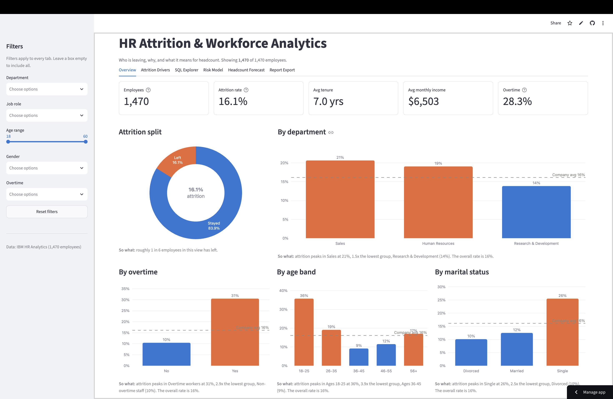
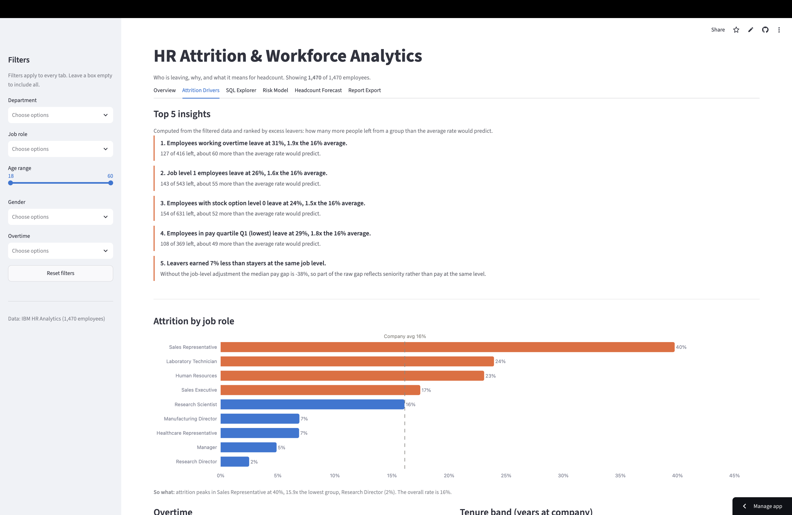
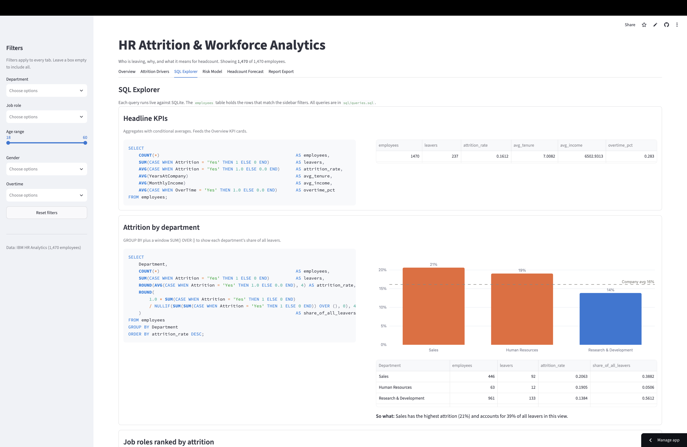
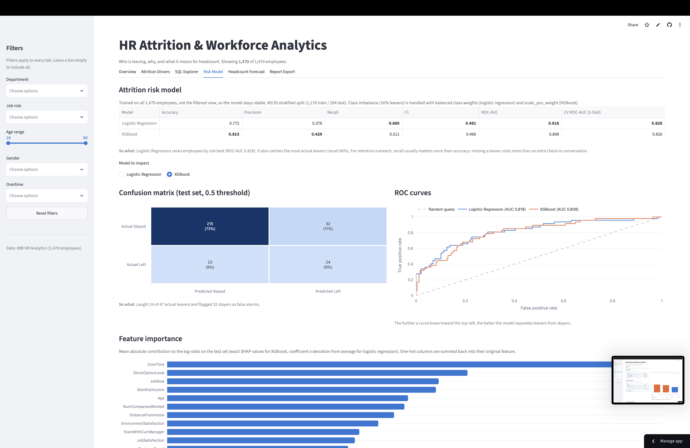

# HR Attrition & Workforce Analytics

An interactive Streamlit dashboard that explains **who leaves, why they leave, and what it means for future headcount**. It is built on the IBM HR Analytics Employee Attrition dataset (1,470 employees) and covers the full analytics workflow: Python data wrangling, SQL (CTEs and window functions), EDA, machine learning, scenario forecasting and automated reporting.

> **Live demo:** _add your Streamlit Community Cloud URL here_

---

## Screenshots

| Overview | Attrition Drivers |
|---|---|
|  |  |

| SQL Explorer | Risk Model |
|---|---|
|  |  |

_Placeholders: save screenshots to `docs/screenshots/` with these file names._

---

## What the app does

| Tab | What you get |
|---|---|
| **Overview** | KPI cards (headcount, attrition rate, average tenure, average income, overtime %) with deltas against the company when filters are active. Attrition split by department, overtime, age and marital status. |
| **Attrition Drivers** | Attrition by job role, overtime, tenure band, salary band, satisfaction, work-life balance, promotion gap, travel and job level. A correlation heatmap. **Top 5 insights in plain English, computed live from the filtered data** and ranked by "excess leavers" (leavers above what the average rate predicts). |
| **SQL Explorer** | 8 SQL queries run live on SQLite, each shown beside its result table, chart and a "so what" line: GROUP BY, CTEs, `RANK`, `DENSE_RANK`, `NTILE`, `LAG`, running `SUM() OVER`, and `AVG() OVER (PARTITION BY ...)`. Also a **read-only query box** for your own SELECTs. |
| **Risk Model** | Logistic regression and XGBoost with class-imbalance handling. Accuracy, precision, recall, F1, ROC-AUC, 5-fold CV AUC, confusion matrix, ROC curves and feature importance. A **"Predict employee risk" form** returns a probability per model and the top contributing factors (exact SHAP values for XGBoost). |
| **Headcount Forecast** | Monthly headcount simulation per department. Sliders for growth target, attrition change, backfill rate and horizon. Baseline vs scenario chart with a Monte Carlo P10-P90 band. |
| **Report Export** | Excel workbook (Summary, By Department, By Job Role and Data sheets), a PDF brief, and an HTML summary with interactive charts. Every export respects the current filters. |

Sidebar filters (department, job role, age range, gender, overtime) apply to **every tab**, including the SQL queries.

---

## Key findings

From the full dataset of 1,470 employees, with an overall attrition rate of 16.1%:

1. **Overtime is the biggest lever.** Overtime workers leave at **31%**, against **10%** for everyone else. They account for about 60 more leavers than the average rate would predict.
2. **Attrition is front-loaded.** Employees with 0-1 years of tenure leave at **35%**, and **51% of all leavers go within 3 years**. Retention drops sharply after year 2.
3. **Junior, low-paid roles carry the risk.** Sales Representatives (**40%**), Laboratory Technicians (**24%**) and Job Level 1 (**26%**) top the list. The lowest pay quartile leaves at **29%**, against **10%** for the highest.
4. **Pay relative to peers matters.** Employees paid more than 10% below their department and job-level peers leave at **20%**, against **14%** for those paid in line with peers.
5. **Gender is not a significant driver** (chi-square p = 0.29). That is a useful fairness baseline for the model.
6. **Model:** logistic regression reaches **ROC-AUC 0.82** on the hold-out set (CV 0.83) with **66% recall** on leavers. XGBoost is close behind (AUC 0.80, CV 0.83) with fewer false alarms but lower recall. On a dataset this small, the simpler and more interpretable model wins. Both models rank overtime as the top risk factor.

_All numbers in the app are computed live, so they change with the filters. The notebook `notebooks/eda.ipynb` walks through the analysis, including chi-square and Mann-Whitney tests._

---

## Tech stack

| Area | Tools |
|---|---|
| App | Streamlit (`st.tabs`, `st.cache_data`, `st.cache_resource`, forms) |
| Data | pandas, NumPy |
| SQL | SQLite (`sqlite3`) with CTEs and window functions. A read-only sandbox uses a SQLite authorizer and `PRAGMA query_only` |
| Visualization | Plotly with one colorblind-checked palette that adapts to light and dark themes |
| ML | scikit-learn (pipelines, logistic regression, stratified CV), XGBoost, TreeSHAP via `pred_contribs` |
| Reporting | openpyxl (Excel), fpdf2 (PDF), Plotly HTML |
| Quality | pytest (48 tests: loader, SQL, read-only guard, forecast, end-to-end app runs), type hints throughout |

---

## Project structure

```
.
├── app.py                    # Streamlit entry point (6 tabs + global sidebar filters)
├── src/
│   ├── data_loader.py        # CSV loading, synthetic fallback, feature engineering, filters, KPIs
│   ├── sql_engine.py         # SQLite build, queries.sql parser, read-only query runner
│   ├── charts.py             # Plotly chart factory and palette
│   ├── insights.py           # Auto-generated plain-English insights
│   ├── model.py              # Logistic regression and XGBoost training, metrics, explanations
│   ├── forecast.py           # Headcount simulation and Monte Carlo band
│   └── report.py             # Excel, PDF and HTML exports
├── sql/queries.sql           # Every SQL query used by the app
├── notebooks/eda.ipynb       # EDA with commentary and statistical tests
├── tests/                    # pytest suite
├── data/                     # CSV goes here. hr_attrition.db is built on first run
├── .streamlit/config.toml    # Theme
├── requirements.txt          # Runtime dependencies (used by Streamlit Cloud)
└── requirements-dev.txt      # + pytest, jupyter, matplotlib, seaborn
```

---

## Run locally

Requires Python 3.10 or newer (tested on 3.13).

```bash
git clone https://github.com/<your-username>/hr-attrition-analytics.git
cd hr-attrition-analytics
python3 -m venv .venv
source .venv/bin/activate          # Windows: .venv\Scripts\activate
pip install -r requirements-dev.txt
streamlit run app.py
```

The app opens at http://localhost:8501.

**Data:** download the dataset from [Kaggle](https://www.kaggle.com/datasets/pavansubhasht/ibm-hr-analytics-attrition-dataset) and save it as `data/hr_attrition.csv`. The original file name `WA_Fn-UseC_-HR-Employee-Attrition.csv` also works. **If no CSV is found, the app generates a realistic synthetic dataset with the same schema** and shows a banner saying so.

Run the tests and the notebook:

```bash
pytest
jupyter notebook notebooks/eda.ipynb
```

---

## Deploy to Streamlit Community Cloud

1. Push the project to a **public GitHub repo**. Include `data/hr_attrition.csv` if you want the deployed app to use the real data. Otherwise it runs on synthetic data.
2. Go to [share.streamlit.io](https://share.streamlit.io) and sign in with GitHub.
3. Click **Create app**, then **Deploy a public app from GitHub**.
4. Pick your repo, set the branch to `main` and the main file path to `app.py`.
5. Under **Advanced settings**, choose **Python 3.12**.
6. Click **Deploy**. The first build installs `requirements.txt` and takes a few minutes. The SQLite database and models are built on first load and then cached.
7. Copy the app URL into the "Live demo" line at the top of this README.

---

## Design notes

- **Filters are global.** The filtered DataFrame is loaded into an in-memory SQLite table for each query, so SQL results always match the charts.
- **The model trains on the full dataset**, not the filtered view, so a narrow filter cannot leave it with too few leavers to learn from.
- **Probabilities are relative risk scores.** Balanced class weights push predicted probabilities above the true 16% base rate, so use them to rank employees, not as calibrated likelihoods.
- **Insights are never hardcoded.** Each insight is picked from every segment of 13 dimensions, filtered to groups of at least 20 employees (or 3% of the view), and ranked by excess leavers.
- **Forecast assumption:** the observed attrition rate is treated as annual. The dataset has no time dimension, and the app states this assumption.
